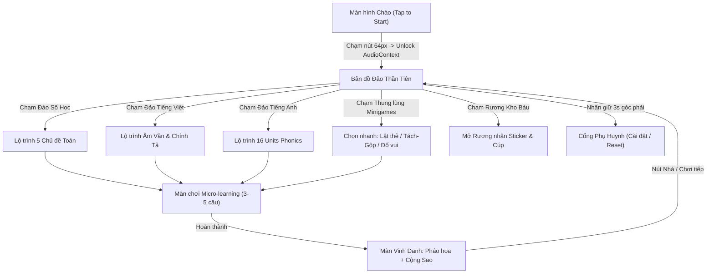
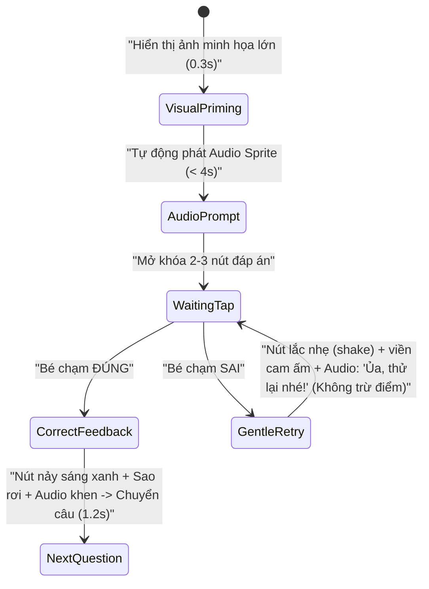

# TÀI LIỆU THIẾT KẾ HỆ THỐNG GIAO DIỆN & LUỒNG TRẢI NGHIỆM TRẺ EM (KIDS DESIGN SYSTEM & UX FLOW)
**Dự án:** Vương Quốc Tri Thức (KidsEdu)  
**Phiên bản:** 1.0 (Sprint 2)  
**Đối tượng mục tiêu:** Trẻ em 6 tuổi (Lớp 1 - Học kỳ 1)  
**Thiết bị ưu tiên:** iPad cũ (iPad Air 1, Mini 2/3, iPad 4 — iOS 12.5.8, RAM 1GB, màn hình 1024x768 / 768x1024) & Smartphone (375x667+)

---

## 1. KIDS DESIGN SYSTEM (HỆ THỐNG THIẾT KẾ CHO TRẺ 6 TUỔI)

### 1.1. Bảng màu tươi sáng & Đạt chuẩn tương phản (WCAG AA >= 4.5:1)
Thiết kế sử dụng nền kem ấm / xanh trời dịu để chống mỏi mắt cho trẻ, kết hợp các khối màu bão hòa cao có **viền đáy 3D đậm** giúp trẻ nhận diện ngay vùng có thể chạm.

| Token CSS | Mã Hex | Màu chữ đi kèm | Tỷ lệ tương phản | Mục đích sử dụng |
|---|---|---|---|---|
| `--bg-sky` | `#E0F2FE` | `#0F172A` | 13.8:1 | Nền bầu trời Bản đồ Đảo & màn hình chung |
| `--bg-cream` | `#FFFBEB` | `#1E293B` | 14.1:1 | Nền thẻ câu hỏi, khung bài học (dịu mắt) |
| `--surface-white` | `#FFFFFF` | `#1E293B` | 15.8:1 | Thẻ đáp án, hộp thoại, thẻ Memory |
| `--primary-blue` | `#1D4ED8` | `#FFFFFF` | 6.7:1 | Nút chính (Bắt đầu, Tiếp tục, Loa đọc) |
| `--primary-blue-shadow` | `#1E3A8A` | — | — | Viền đáy 3D của nút `--primary-blue` |
| `--math-orange` | `#C2410C` | `#FFFFFF` | 5.1:1 | Chủ đề **Đảo Số Học (Toán)** |
| `--math-orange-shadow` | `#7C2D12` | — | — | Viền đáy 3D Đảo Số Học |
| `--vn-emerald` | `#047857` | `#FFFFFF` | 5.4:1 | Chủ đề **Đảo Tiếng Việt** |
| `--vn-emerald-shadow` | `#064E3B` | — | — | Viền đáy 3D Đảo Tiếng Việt |
| `--en-purple` | `#6D28D9` | `#FFFFFF` | 6.5:1 | Chủ đề **Đảo Tiếng Anh** |
| `--en-purple-shadow` | `#4C1D95` | — | — | Viền đáy 3D Đảo Tiếng Anh |
| `--star-gold` | `#FACC15` | `#422006` | 10.6:1 | Sao thưởng, Cúp, Rương kho báu (**Bắt buộc chữ nâu đậm**, không dùng chữ trắng!) |
| `--star-gold-shadow` | `#CA8A04` | — | — | Viền đáy 3D nút Vàng |
| `--success-green` | `#15803D` | `#FFFFFF` | 5.1:1 | Phản hồi chọn ĐÚNG |
| `--retry-amber` | `#B45309` | `#FFFFFF` | 5.0:1 | Phản hồi thử lại nhẹ nhàng (không dùng đỏ gắt) |

### 1.2. Typography tròn trịa, thân thiện tiểu học
- **Font Family ưu tiên:** `'Nunito', 'Quicksand', 'Comic Sans MS', 'Chalkboard SE', -apple-system, BlinkMacSystemFont, sans-serif` (chú ý chữ `a` và `g` đơn giản, nét tròn dễ nhận diện cho học sinh lớp 1).
- **Quy tắc hiển thị chữ:** Hạn chế tối đa đoạn văn bản. Chỉ hiển thị **từ khóa ngắn / chữ số / âm vần** kích thước lớn, luôn đi kèm biểu tượng và nút loa.

| Vai trò | Kích thước (iPad / Mobile) | Weight | Line-height | Ghi chú |
|---|---|---|---|---|
| **Chữ số / Âm vần trung tâm** | `48px` / `36px` | `800` | `1.1` | Dùng cho phép tính, chữ cái ghép vần |
| **Tiêu đề màn chơi / Từ vựng** | `28px` / `22px` | `800` | `1.2` | Tối đa 3-5 từ |
| **Số trên nút đáp án** | `32px` / `26px` | `800` | `1.0` | Căn giữa tuyệt đối |
| **Chỉ số HUD (Số sao, tiến độ)** | `20px` / `18px` | `700` | `1.0` | Luôn đi kèm icon ngôi sao / rương |

### 1.3. Token khoảng cách & Nút bấm 3D nổi (Safari iOS 12.5.8 Ready)
**Ràng buộc bắt buộc:**
- **KHÔNG dùng `gap` trong `display: flex`** (gây vỡ layout trên Safari iOS 12.5.8). Dùng `margin` hoặc phần trăm kích thước.
- **KHÔNG dùng CSS Nesting** (viết selector phẳng).
- **Kích thước chạm tối thiểu:** `64px x 64px` (nút điều hướng phụ tối thiểu `48px x 48px`), khoảng cách giữa 2 nút liên tiếp `>= 16px`.

```css
/* =========================================================
   KIDS DESIGN SYSTEM - BASE TOKENS & SAFARI 12 COMPATIBLE
   ========================================================= */
html, body {
  margin: 0;
  padding: 0;
  width: 100%;
  height: 100%;
  overflow: hidden;
  background-color: #E0F2FE;
  font-family: 'Nunito', 'Quicksand', 'Chalkboard SE', -apple-system, sans-serif;
  color: #1E293B;
  /* Chống zoom, chống bôi đen, chống cuộn đàn hồi trên iPad */
  touch-action: manipulation;
  overscroll-behavior: none;
  -webkit-user-select: none;
  -webkit-touch-callout: none;
  -webkit-tap-highlight-color: transparent;
}

/* Nút bấm 3D chuẩn (>= 64x64px) */
.kid-btn {
  display: inline-block;
  min-width: 64px;
  min-height: 64px;
  padding: 14px 28px;
  border: none;
  border-radius: 20px;
  font-size: 24px;
  font-weight: 800;
  color: #FFFFFF;
  background-color: #1D4ED8;
  /* Hiệu ứng khối nổi 3D nhẹ GPU (chỉ 1 lớp shadow cứng) */
  box-shadow: 0 6px 0 #1E3A8A;
  cursor: pointer;
  text-align: center;
  vertical-align: middle;
  -webkit-transform: translate3d(0, 0, 0);
  transform: translate3d(0, 0, 0);
  -webkit-transition: -webkit-transform 0.1s ease, box-shadow 0.1s ease;
  transition: transform 0.1s ease, box-shadow 0.1s ease;
}

/* Hiệu ứng lún xuống khi bé chạm */
.kid-btn:active,
.kid-btn.is-pressed {
  -webkit-transform: translate3d(0, 4px, 0) scale(0.96);
  transform: translate3d(0, 4px, 0) scale(0.96);
  box-shadow: 0 2px 0 #1E3A8A;
}

/* Khoảng cách an toàn >= 16px thay cho flexbox gap */
.kid-btn-group {
  display: -webkit-box;
  display: -webkit-flex;
  display: flex;
  -webkit-box-pack: center;
  -webkit-justify-content: center;
  justify-content: center;
  -webkit-flex-wrap: wrap;
  flex-wrap: wrap;
  margin-left: -8px;
  margin-right: -8px;
}

.kid-btn-group .kid-btn,
.kid-btn-group .kid-card-option {
  margin: 8px; /* Tạo khoảng cách thực tế 16px giữa hai phần tử liền kề */
}

/* Nút Loa đọc to rõ (Audio-First) */
.kid-btn-speaker {
  width: 68px;
  height: 68px;
  padding: 0;
  border-radius: 50%;
  background-color: #FACC15;
  color: #422006;
  box-shadow: 0 6px 0 #CA8A04;
  font-size: 32px;
  line-height: 68px;
}

.kid-btn-speaker:active {
  box-shadow: 0 2px 0 #CA8A04;
}
```

---

## 2. BẢN ĐỒ ĐẢO THẦN TIÊN (INTERACTIVE WORLD MAP)

### 2.1. Nguyên tắc thiết kế Bản đồ
- **Không text điều hướng rườm rà:** Mỗi hòn đảo hiển thị **Icon đại diện lớn + Nhân vật Mascot + Thanh sao tiến độ + Tên ngắn (1-2 từ)** và tự phát âm thanh khi bé chạm vào (ví dụ: *"Chào mừng bé đến Đảo Số Học!"*).
- **Tối ưu GPU iPad cũ:** Không dùng `backdrop-filter: blur()` trên thanh HUD. Thanh HUD dùng nền trắng đục `rgba(255, 255, 255, 0.95)` với viền bo tròn `border: 3px solid #BAE6FD`.
- **Cổng Phụ Huynh (COPPA):** Nút bánh răng cài đặt nhỏ ở góc trên phải yêu cầu **Nhấn giữ 3 giây** (hiển thị vòng tròn nạp tiến độ) để trẻ không bấm nhầm.

### 2.2. Wireframe Layout Bản đồ (iPad Landscape 1024x768)

```text
+-----------------------------------------------------------------------------------+
| [AVATAR: Bé Rồng]  [⭐ 45]      VƯƠNG QUỐC TRI THỨC         [🔊 Nhạc] [⚙️ Giữ 3s] |
+-----------------------------------------------------------------------------------+
|                                                                                   |
|      ╭───────────────────╮                          ╭───────────────────╮         |
|      │   🔢 1 + 2 = 3    │                          │   📖 A B C ...    │         |
|      │  [Robot Thông Thái]│     ~ ~ ~ ~ ~ ~ ~ ~      │   [Hà & Nam]      │         |
|      │   ĐẢO SỐ HỌC      │  ~ ~  (Đường mây) ~ ~    │  ĐẢO TIẾNG VIỆT   │         |
|      │  ⭐⭐⭐ (12/20)    │                          │  ⭐⭐☆ (8/20)     │         |
|      ╰───────────────────╯                          ╰───────────────────╯         |
|                \                                              /                   |
|                 \        ╭───────────────────────────╮       /                    |
|                  \       │     🎁 RƯƠNG KHO BÁU      │      /                     |
|                   ──────>│  (Mở khi đủ 10 sao mỗi đảo)│<────                      |
|                          ╰───────────────────────────╯                            |
|                                        |                                          |
|      ╭───────────────────╮             v            ╭───────────────────╮         |
|      │   🦁 Hello! Cat   │                          │  🎮 Lật Thẻ / Đua  │         |
|      │  [Phonic Phil]    │                          │   [Thỏ Năng Động] │         |
|      │  ĐẢO TIẾNG ANH    │                          │THUNG LŨNG MINIGAME│         |
|      │  ⭐☆☆ (5/16)      │                          │   [Chơi tự do]    │         |
|      ╰───────────────────╯                          ╰───────────────────╯         |
+-----------------------------------------------------------------------------------+
```

> **Responsive Mobile Portrait (375x667):** Chuyển 4 cụm đảo thành danh sách **2 cột x 2 hàng** hoặc **cuộn dọc 1 cột lớn** (`width: 88%`, `min-height: 140px`, `margin-bottom: 16px`), vẫn giữ nguyên vùng chạm toàn bộ hòn đảo.

### 2.3. Luồng điều hướng tổng thể (Mermaid Flow)



---

## 3. LUỒNG TRẢI NGHIỆM MINIGAME (UX FLOWS & LAYOUTS)

Mọi màn chơi đều dùng chung **Khung DOM tái sử dụng (DOM Recycling)** gồm 3 tầng cố định để không gây tràn RAM 1GB trên iPad cũ:
1. **Top HUD (`height: 72px`):** Nút Quay lại (`64x64px` icon mũi tên trái), Thanh tiến độ dạng đốt ngọc (5 viên ngọc sáng dần theo từng câu), Bộ đếm Sao (`⭐`).
2. **Stage Area (Vùng trung tâm):** Chứa hình ảnh trực quan (Visual Priming) + Nút Loa phát âm.
3. **Interaction Deck (Vùng thao tác dưới):** Chứa các thẻ đáp án hoặc khay chọn (`>= 64px`, cách nhau `>= 16px`).

---

### 3.1. Chế độ 1: Lật thẻ Memory Card (Đã fix lỗi tràn Grid)

#### Nguyên nhân lỗi tràn cũ & Giải pháp chuẩn:
- Không để chiều cao thẻ cố định bằng `px` cứng (gây tràn dọc trên iPad `768px` hoặc iPhone `667px`).
- Tính toán vùng chứa `.memory-board` nằm gọn trong `calc(100vh - 104px)` (trừ đi HUD `72px` và padding `32px`), dùng `margin` thay cho `gap`.
- Hỗ trợ 2 cấp độ lưới:
  - **Cấp độ dễ (4 thẻ - 2x2):** Khởi động HK1.
  - **Cấp độ chuẩn (6 thẻ - 3 cột x 2 hàng trên iPad; 2 cột x 3 hàng trên Mobile dọc).**
  - **Cấp độ mở rộng (8 thẻ - 4 cột x 2 hàng trên iPad; 2 cột x 4 hàng trên Mobile dọc).**

#### Wireframe Layout (Lưới 3x2 trên iPad):
```text
+-------------------------------------------------------------------+
|  [<-]   [💎][💎][⚪][⚪][⚪]   [🔊 Nghe lại]              [⭐ 45]  |
+-------------------------------------------------------------------+
|                                                                   |
|     +---------------+   +---------------+   +---------------+     |
|     |               |   |      🔺       |   |               |     |
|     |      ❓       |   |   Tam giác    |   |      ❓       |     |
|     |               |   |               |   |               |     |
|     +---------------+   +---------------+   +---------------+     |
|                                                                   |
|     +---------------+   +---------------+   +---------------+     |
|     |      🍕       |   |               |   |               |     |
|     |  Miếng bánh   |   |      ❓       |   |      ❓       |     |
|     |               |   |               |   |               |     |
|     +---------------+   +---------------+   +---------------+     |
|                                                                   |
+-------------------------------------------------------------------+
```

#### CSS Fix Tràn Grid (Safari 12 Compatible):
```css
.memory-stage {
  width: 100%;
  height: calc(100vh - 88px);
  padding: 12px 16px;
  box-sizing: border-box;
  display: -webkit-box;
  display: -webkit-flex;
  display: flex;
  -webkit-box-align: center;
  -webkit-align-items: center;
  align-items: center;
  -webkit-box-pack: center;
  -webkit-justify-content: center;
  justify-content: center;
}

.memory-board {
  width: 100%;
  max-width: 780px;
  height: 100%;
  max-height: 540px;
  display: -webkit-box;
  display: -webkit-flex;
  display: flex;
  -webkit-flex-wrap: wrap;
  flex-wrap: wrap;
  -webkit-box-pack: center;
  -webkit-justify-content: center;
  justify-content: center;
  -webkit-align-content: center;
  align-content: center;
}

/* Lưới 3 cột x 2 hàng (tính trừ 16px margin mỗi thẻ) */
.memory-card-slot {
  width: calc(33.333% - 16px);
  height: calc(50% - 16px);
  min-width: 80px;
  min-height: 80px;
  margin: 8px;
  box-sizing: border-box;
  -webkit-perspective: 800px;
  perspective: 800px;
}

@media (max-width: 600px) {
  /* Mobile dọc: 2 cột x 3 hàng */
  .memory-card-slot {
    width: calc(50% - 16px);
    height: calc(33.333% - 16px);
  }
}
```

---

### 3.2. Chế độ 2: Tap-to-Select / Tap-to-Place (Thay thế Kéo-Thả)

Áp dụng cho **Tách - Gộp số (Toán)** và **Nối toa tàu ghép vần (Tiếng Việt)**.

#### Luồng tương tác 2 nhịp:
1. **Nhịp 1 (Chạm nguồn):** Bé chạm vào một vật thể / toa chữ ở khay dưới. Vật thể lập tức **phóng to 1.08x + viền sáng vàng `#FACC15` + nảy nhẹ** (trạng thái `.is-selected`), đồng thời các **ô đích hợp lệ** ở trên bắt đầu nhấp nháy viền nét đứt mời gọi.
2. **Nhịp 2 (Chạm đích):** Bé chạm vào ô đích. Vật thể tự động di chuyển mượt mà vào ô đích (dùng `translate3d` hoặc cập nhật vào slot đích kèm hiệu ứng pop-in) và phát âm thanh đọc to từ/số vừa ghép.
3. **Hoàn tác dễ dàng:** Chạm lại vào vật thể đã đặt trong ô đích để trả về khay dưới nếu bé muốn đổi.

#### Wireframe Layout A: Tách - Gộp Số (Ví dụ: 5 gồm 3 và mấy?)
```text
+-------------------------------------------------------------------+
|  [<-]   [💎][💎][⚪][⚪][⚪]                              [⭐ 45]  |
+-------------------------------------------------------------------+
|  [🔊]  "5 quả táo gồm 3 quả ở đĩa trái và mấy quả ở đĩa phải?"    |
|                                                                   |
|                    ╭───────────────────────╮                      |
|                    │   🍎 🍎 🍎 🍎 🍎 (5)  │                      |
|                    ╰───────────┬───────────╯                      |
|                        /               \                          |
|       ╭─────────────────╮             ╭─────────────────╮         |
|       │  🍎 🍎 🍎  (3)  │             │   [ ? ] (Chạm   │         |
|       │   (Đã cố định)  │             │   để đặt vào)   │         |
|       ╰─────────────────╯             ╰─────────────────╯         |
|                                                                   |
|  ------------------ KHAY CHỌN (Tap-to-Select) ------------------  |
|        [ 1 quả 🍎 ]       [ 2 quả 🍎🍎 ]       [ 4 quả 🍎🍎🍎🍎 ]  |
|       (Chạm chọn -> Nhịp 1: Sáng viền vàng -> Chạm ô [?])         |
+-------------------------------------------------------------------+
```

#### Wireframe Layout B: Nối Toa Tàu Ghép Vần (Ví dụ: `b` + `a` + dấu sắc = `bá`)
```text
+-------------------------------------------------------------------+
|  [<-]   [💎][⚪][⚪][⚪][⚪]                              [⭐ 45]  |
+-------------------------------------------------------------------+
|  [🔊]  "Bé hãy ghép âm 'b' và vần 'a' thành tiếng 'ba' nhé!"      |
|                                                                   |
|   🚂 ĐẦU TÀU        [  b  ]      +      [  _?_  ]   =   [ ba 🔊 ] |
|   (Vui nhộn)       (Âm đầu)             (Ô Vần)        (Kết quả)  |
|                                                                   |
|  ------------------ KHAY TOA CHỮ (Tap-to-Select) ---------------- |
|         [  a  ]            [  o  ]            [  ê  ]             |
|        (64x64px+)         (64x64px+)         (64x64px+)           |
+-------------------------------------------------------------------+
```

---

### 3.3. Chế độ 3: Đố vui 2-3 lựa chọn (Visual Priming & Phi trừng phạt)

Tuân thủ **Quy tắc vàng 5**: Tối đa **2 đến 3 lựa chọn** cho Học kỳ 1. Hình ảnh xuất hiện trước, câu lệnh Audio dưới 4 giây tự động phát (kèm nút Loa to để nghe lại).

#### Wireframe Layout:
```text
+-------------------------------------------------------------------+
|  [<-]   [💎][💎][💎][⚪][⚪]                              [⭐ 45]  |
+-------------------------------------------------------------------+
|                                                                   |
|            ╭─────────────────────────────────────────╮            |
|            │   [🔊]   (Ảnh minh họa lớn rõ nét)      │            |
|            │                                         │            |
|            │         🍎  🍎  🍎  🍎                 │            |
|            │                                         │            |
|            ╰─────────────────────────────────────────╯            |
|                                                                   |
|      +-----------------+   +-----------------+   +-------------+  |
|      |        3        |   |        4        |   |      5      |  |
|      +-----------------+   +-----------------+   +-------------+  |
|      (>= 100x88px, khoảng cách giữa các nút >= 16px)              |
+-------------------------------------------------------------------+
```

#### Luồng phản hồi Phi trừng phạt (Non-punitive Feedback Flow):


---

## 4. ANIMATION & HAPTIC/VISUAL FEEDBACK SPECS (TỐI ƯU GPU iPAD A7/A8)

### 4.1. Nguyên tắc hiệu năng (60fps trên chip A7/A8, RAM 1GB)
- **Chỉ animate `transform` (`translate3d`, `scale`, `rotate`) và `opacity`.**
- **Tuyệt đối tránh animate** `width`, `height`, `top`, `left`, `box-shadow` hay `filter: blur()` vì sẽ kích hoạt Layout/Paint lại trên mỗi khung hình gây giật lag hoặc văng Safari.
- **Particle (Pháo hoa / Sao rơi):** Giới hạn tối đa **12-16 phần tử DOM tái sử dụng** (hoặc 1 `<canvas>` nhẹ kích thước cố định, `clearRect` sạch sau 1.2 giây), không tạo mới hàng trăm thẻ `<div>` mỗi lần thắng.

### 4.2. Bộ Keyframes chuẩn (`-webkit-` Prefixed)

```css
/* 1. Phản hồi chạm đúng: Nảy vui tươi (Pop & Bounce) */
@-webkit-keyframes kidBounceCorrect {
  0%   { -webkit-transform: translate3d(0, 0, 0) scale(1); }
  40%  { -webkit-transform: translate3d(0, -10px, 0) scale(1.1); }
  70%  { -webkit-transform: translate3d(0, 2px, 0) scale(0.97); }
  100% { -webkit-transform: translate3d(0, 0, 0) scale(1); }
}
@keyframes kidBounceCorrect {
  0%   { transform: translate3d(0, 0, 0) scale(1); }
  40%  { transform: translate3d(0, -10px, 0) scale(1.1); }
  70%  { transform: translate3d(0, 2px, 0) scale(0.97); }
  100% { transform: translate3d(0, 0, 0) scale(1); }
}

/* 2. Phản hồi chạm sai nhẹ nhàng: Lắc ngang biên độ nhỏ (Gentle Shake) */
@-webkit-keyframes kidGentleShake {
  0%, 100% { -webkit-transform: translate3d(0, 0, 0); }
  25%      { -webkit-transform: translate3d(-6px, 0, 0); }
  50%      { -webkit-transform: translate3d(6px, 0, 0); }
  75%      { -webkit-transform: translate3d(-4px, 0, 0); }
}
@keyframes kidGentleShake {
  0%, 100% { transform: translate3d(0, 0, 0); }
  25%      { transform: translate3d(-6px, 0, 0); }
  50%      { transform: translate3d(6px, 0, 0); }
  75%      { transform: translate3d(-4px, 0, 0); }
}

/* 3. Nhịp thở nhẹ cho Mascot & Nút Loa mời gọi (Idle Pulse) */
@-webkit-keyframes kidFloatIdle {
  0%, 100% { -webkit-transform: translate3d(0, 0, 0); }
  50%      { -webkit-transform: translate3d(0, -5px, 0); }
}
@keyframes kidFloatIdle {
  0%, 100% { transform: translate3d(0, 0, 0); }
  50%      { transform: translate3d(0, -5px, 0); }
}

/* Class gắn kích hoạt */
.anim-correct {
  background-color: #15803D !important;
  box-shadow: 0 6px 0 #14532D !important;
  -webkit-animation: kidBounceCorrect 0.45s ease-out;
  animation: kidBounceCorrect 0.45s ease-out;
}

.anim-retry {
  background-color: #B45309 !important;
  box-shadow: 0 6px 0 #78350F !important;
  -webkit-animation: kidGentleShake 0.35s ease-in-out;
  animation: kidGentleShake 0.35s ease-in-out;
}

.anim-float {
  -webkit-animation: kidFloatIdle 2.6s ease-in-out infinite;
  animation: kidFloatIdle 2.6s ease-in-out infinite;
}
```

### 4.3. Bảng quy chuẩn Phản hồi Đa giác quan (Visual + Audio Specs)

| Sự kiện | Hiệu ứng Hình ảnh (Visual) | Hiệu ứng Âm thanh (Audio Sprite) | Thời lượng |
|---|---|---|---|
| **Chạm nút bất kỳ** | Lún xuống `translate3d(0, 4px, 0) scale(0.96)` | Tiếng *"Pop"* ngắn nhẹ (`< 0.1s`) | `100ms` |
| **Tap-to-Select (Nhịp 1)** | Phóng to `scale(1.06)`, viền vàng `#FACC15` `4px` | Tiếng *"Ting"* nhẹ | `150ms` |
| **Chọn ĐÚNG** | Nút đổi xanh `#15803D` + `kidBounceCorrect` + 12 ngôi sao rơi | Nhạc leng keng + *"Đúng rồi! Giỏi quá!"* | `1200ms` |
| **Chọn SAI** | Nút đổi cam ấm `#B45309` + `kidGentleShake` (không dấu X đỏ) | Tiếng *"Boing"* mềm + *"Ủa, thử lại nhé!"* | `400ms` |
| **Hoàn thành màn chơi** | Popup Cúp Vàng + 16 hạt confetti rơi + Mascot vỗ tay | Nhạc chiến thắng 2s + cộng dồn sao | `2500ms` |
