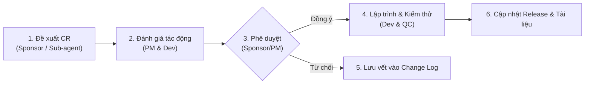

# QUẢN TRỊ RỦI RO & QUY TRÌNH THAY ĐỔI (RISK & CHANGE MANAGEMENT)
**Tiêu chuẩn áp dụng:** PMI PMBOK - Identify Risk, Plan Risk Response & Assess/Implement Changes  
**Dự án:** Vương Quốc Tri Thức (KidsEdu)  

---

## 1. SỔ ĐĂNG KÝ RỦI RO (RISK REGISTER)

| Mã Rủi Ro | Mô tả rủi ro | Khả năng (L: 1-5) | Tác động (I: 1-5) | Điểm rủi ro ($L \times I$) | Chiến lược đối phó | Kế hoạch phòng ngừa & Xử lý (Response & Contingency) | Người phụ trách |
|---|---|:---:|:---:|:---:|---|---|---|
| **RSK-01** | **Rò rỉ cú pháp ES6+** làm trắng trang trên Safari iOS 12.5.8 | 4 | 5 | **20 (Cực cao)** | Tránh né (Avoid) | - Cài đặt hook kiểm tra tự động trước mỗi lần commit. - QC chạy script kiểm tra tĩnh `grep` và `node -c`. - Bắt buộc chạy thử trên iPad vật lý trước khi release. | Dev & QC |
| **RSK-02** | **Trẻ nhanh chán** do nội dung học lặp lại hoặc thiếu thử thách | 4 | 4 | **16 (Cao)** | Giảm thiểu (Mitigate) | - Thiết kế hệ thống Gamification đa tầng: mở khóa đảo mới, linh vật đồng hành, minigame giải trí sau mỗi 3 bài học. - Dynamic difficulty: độ khó tự điều chỉnh theo kết quả của bé. | BA & UI/UX |
| **RSK-03** | **Chính sách Autoplay Audio của Safari** chặn phát nhạc/tiếng | 3 | 4 | **12 (Vừa)** | Tránh né (Avoid) | - Triển khai cơ chế Audio Context Unlock ngay màn hình đầu tiên. - Lưu trạng thái tương tác vào Session, dự phòng Fallback SpeechSynthesis. | Dev |
| **RSK-04** | **Lỗi tràn giao diện (UI Overflow)** trên các độ phân giải màn hình khác nhau | 3 | 3 | **9 (Vừa)** | Giảm thiểu (Mitigate) | - Quy định responsive layout với `max-width: 640px` cho khung điện thoại, grid co giãn tỷ lệ cho iPad. - Tránh dùng kích thước pixel cố định cho vùng chứa nhiều icon. | UI/UX & Dev |
| **RSK-05** | **Xung đột ghi đè đồng bộ đám mây Firebase** khi chuyển qua lại nhiều máy | 2 | 4 | **8 (Vừa)** | Chuyển giao / Giảm thiểu | - Cơ chế Timestamp Merge: Luôn giữ tiến trình có điểm số hoặc thời gian mới hơn. - Backup dữ liệu LocalStorage trước khi nạp dữ liệu từ Cloud. | Dev |
| **RSK-06** | **Cảnh báo bảo mật từ GitHub Secret Scanning** đối với Firebase API Key | 2 | 2 | **4 (Thấp)** | Chấp nhận có kiểm soát | - Giải thích rõ với Sponsor: API Key Firebase Client chỉ là bộ định danh dự án công khai. - Cấu hình Firebase Realtime Database Security Rules giới hạn quyền đọc/ghi. | Dev & PM |

---

## 2. QUY TRÌNH KIỂM SOÁT THAY ĐỔI (CHANGE CONTROL PROCESS)

Để chấm dứt tình trạng "chỉnh sửa chắp vá, manh mún" trong quá khứ, mọi yêu cầu thay đổi (Change Request - CR) phải tuân theo chu trình 5 bước PMI chuẩn hóa:

### 2.1. Biểu mẫu đề xuất thay đổi tóm tắt (Simple Change Request)
1. **Mã số CR:** `CR-YYYYMMDD-XX`
2. **Nội dung yêu cầu:** Mô tả rõ thay đổi về UI, logic, nội dung SGK hay kỹ thuật.
3. **Lý do thay đổi:** Giải quyết lỗi (Bugfix), nâng cao trải nghiệm bé (UX Enhancement), hay bổ sung nội dung mới (New Content).
4. **Đánh giá tác động (Impact Analysis):**
   - Tác động đến độ tương thích ES5 / iOS 12.5.8: Có ảnh hưởng không?
   - Tác động đến tiến độ (Schedule) và phạm vi (Scope).
5. **Quyết định:** Phê duyệt (Approved) / Từ chối (Rejected) / Hoãn lại (Deferred).
