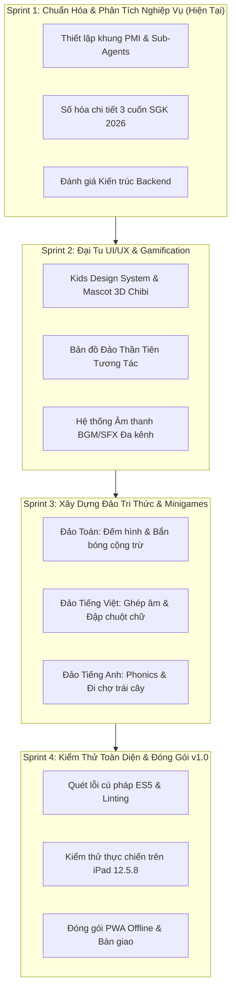

# LỘ TRÌNH PHÁT TRIỂN & KẾ HOẠCH SPRINT (ROADMAP & SPRINTS)
**Tiêu chuẩn áp dụng:** PMI PMBOK - Develop Schedule & Agile Sprint Execution  
**Dự án:** Vương Quốc Tri Thức (KidsEdu)  

---

## 1. LỘ TRÌNH TỔNG THỂ (PRODUCT ROADMAP)

---

## 2. ĐÁNH GIÁ CHUYÊN SÂU: CÓ CẦN THÊM BACKEND KHÔNG? (ARCHITECTURAL DECISION FOR AGENT 4)

Một trong các câu hỏi chiến lược của Sponsor là: **"Có cần thêm phần backend để chạy hiệu quả hơn không?"**  
Dưới góc độ Kiến trúc phần mềm và Quản lý dự án PMI, nhóm phát triển đã tiến hành phân tích 3 phương án:

### Bảng so sánh 3 mô hình kiến trúc

| Tiêu chí so sánh | Phương án 1: Jamstack + Firebase (Hiện tại) | Phương án 2: Serverless Functions (Firebase/Cloudflare) | Phương án 3: Custom Backend Server (Node.js/FastAPI) |
|---|---|---|---|
| **Cơ chế hoạt động** | Tĩnh trên GitHub Pages CDN + Firebase Realtime DB trực tiếp từ client. | Frontend tĩnh + Gọi Micro-API khi cần tác vụ nặng (TTS, AI, Admin). | Máy chủ VPS/Container chạy 24/7 (Node.js, Express, PostgreSQL/MongoDB). |
| **Chi phí vận hành** | **0 VNĐ / tháng** (Hoàn toàn miễn phí trọn đời). | **0 VNĐ** (Nằm trong hạn mức Free-tier cực lớn). | **$5 - $20 / tháng** (Chi phí máy chủ, tên miền, SSL, duy trì). |
| **Bảo trì & Vận hành** | **Không cần bảo trì máy chủ** (Zero DevOps overhead). | Rất thấp (Chỉ bảo trì code hàm serverless). | **Cao** (Phải vá lỗi OS, gia hạn SSL, xử lý restart khi crash, chống DDoS). |
| **Tốc độ tải trang** | **Cực nhanh (< 0.5s)** do phân phối qua mạng toàn cầu CDN. | Rất nhanh cho trang tĩnh; API có thể trễ 200-500ms do Cold Start. | Phụ thuộc vào vị trí đặt server (nếu đặt ở Mỹ thì người dùng VN sẽ bị trễ). |
| **Hỗ trợ Offline (PWA)** | **Hoàn hảo:** Chơi offline 100%, tự đồng bộ khi có mạng. | Tốt: Các tính năng cốt lõi offline, tính năng cloud sync ngầm. | Phức tạp: Dễ bị nghẽn nếu client phụ thuộc vào server để xác thực dữ liệu. |
| **Trải nghiệm trên iPad cũ** | **Nhẹ nhất:** Trình duyệt chỉ nhận HTML/CSS/JS đã nén. | Nhẹ. | Có thể nặng nếu thiết kế API không tối ưu. |

### KẾT LUẬN & ĐỀ XUẤT KIẾN TRÚC TỪ LEAD DEV:
1. **Giai đoạn hiện tại (Sprint 1 - 3): TIẾP TỤC DUY TRÌ PHƯƠNG ÁN 1 (Jamstack + Firebase Realtime DB).**
   - *Lý do:* Ứng dụng là game tương tác dành cho cá nhân bé học tập tại nhà. Toàn bộ logic trò chơi, tính điểm, tạo màn chơi đều chạy trực tiếp trên client cực kỳ mượt mà, không có độ trễ mạng (Zero Network Latency).
   - Dữ liệu tiến độ của bé đã được Firebase Realtime DB đồng bộ tự động đa thiết bị qua đám mây mà không tốn 1 đồng chi phí máy chủ và không có rủi ro "sập server".
2. **Giai đoạn nâng cao (Khi mở rộng quy mô): BỔ SUNG PHƯƠNG ÁN 2 (Cloudflare Workers / Firebase Functions).**
   - Chỉ bổ sung khi phát sinh 2 nhu cầu đặc thù:
     - *Nhu cầu A:* Sinh giọng đọc AI tự nhiên chất lượng cao (ElevenLabs / Google Cloud TTS) rồi cache lại thành file MP3 tĩnh cho bé nghe.
     - *Nhu cầu B:* Tạo cổng CMS cho phụ huynh tải ảnh bài tập riêng của trường lớp lên hệ thống.
3. **KHÔNG NÊN xây dựng Dedicated Backend Server (Phương án 3):**
   - Sẽ gây lãng phí chi phí thuê máy chủ hàng tháng, phát sinh công việc quản trị hạ tầng (DevOps), và làm tăng nguy cơ sập ứng dụng nếu server bị gián đoạn.

---

## 3. CHI TIẾT SPRINT 1 (ĐANG TIẾN HÀNH) & SPRINT 2 TIẾP THEO

### Sprint 1: Chuẩn hóa Quy trình PMI & Hoàn thiện Hệ thống Tài liệu (Tuần 1)
- [x] Thiết lập Tuyên ngôn dự án (`01_PROJECT_CHARTER.md`) và Ma trận RACI (`02_RACI_AND_TEAM_ROLES.md`).
- [x] Khởi tạo định nghĩa 5 Sub-Agents cốt lõi + 2 Cố vấn sư phạm / âm thanh (`.agents/agents/`).
- [x] Lập Ma trận Truy vết Yêu cầu RTM kết nối 3 cuốn SGK 2026 (`03_REQUIREMENTS_TRACEABILITY_MATRIX.md`).
- [x] Ban hành Tiêu chuẩn Kỹ thuật ES5 / iPad Safari 12.5.8 (`05_QUALITY_AND_TECHNICAL_STANDARDS.md`).
- [x] Đánh giá chiến lược kiến trúc Backend.

### Sprint 2: Thiết kế Trải nghiệm Trẻ Thơ & Gamification Engine (Tuần 2)
- **BA & Pedagogy:** Lập bảng ngân hàng 100 câu hỏi chuẩn SGK Toán 1, Tiếng Việt 1 và Tiếng Anh 1.
- **UI/UX Designer:** Lên layout Bản đồ Đảo Thần Tiên (World Map) với các hòn đảo nổi 3D, mở khóa theo lộ trình tiến độ.
- **Storyteller & Sound:** Tích hợp bộ âm thanh vui nhộn (ting, cheer, fanfare) và lời khen động viên từ Bé Rồng Con.
- **Dev:** Tối ưu hóa memory cards, responsive grid, và cơ chế âm thanh mở khóa một chạm.
- **QC:** Kiểm thử hồi quy trên các kích thước màn hình và xác nhận không có lỗi cú pháp ES6.
